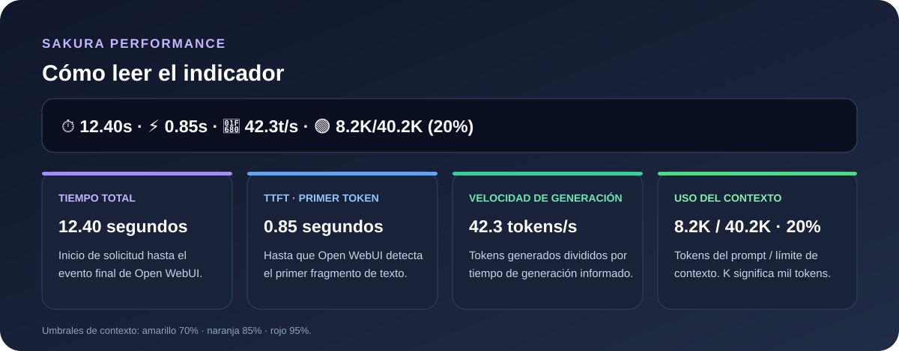

# Sakura Performance

Filtro de Open WebUI que mide cada respuesta de un modelo servido por `llama.cpp`: cuánto tardó, cuándo empezó a responder, a qué velocidad generó y cuánto contexto ocupa. **Sakura es el nombre de esta configuración; puedes usarlo con otros modelos de IA.**

Desde la versión 2 mide el **mensaje completo**: cuando el modelo usa herramientas (búsqueda web, comandos, scripts, memoria), Open WebUI hace varias vueltas al modelo y el filtro las suma todas, no solo la primera.

Ejemplos en Open WebUI:

```text
⏱️ 2.10s · ⚡ 0.62s · 🚀 98.3t/s · 🟢 8.4K/81.9K (10%)
⏱️ 23.94s · ⚡ 3.18s · 🚀 81.8t/s · 🟢 18.1K/81.9K (22%) · 🤔 6.3s + 🔧 2 en 7.9s + ✍️ 9.7s = 23.9s
⏱️ 6.40s · ⚡ 0.58s · 🚀 97.8t/s · 🟢 12.1K/81.9K (15%) · 🤔 1.9s + 🔧 1 en 0.3s + ✍️ 4.2s = 6.4s · 💾 leyó 3, guardó 1 · 🔊 RTF 0.45
```

## Archivos

- `filter.py`: el filtro de Open WebUI (versión 2.2.0).
- `ver_rendimiento.py`: resumen del historial que guarda el filtro (opcional).
- `metrics.py`: servicio Flask local con los endpoints `/health` y `/snapshot` (opcional).
- `start_sakura.ps1`: inicia el helper de métricas y `llama-server` con los parámetros de ejemplo.
- `requirements.txt`: dependencias del helper.

## Cómo leer la línea



Los cuatro primeros datos aparecen siempre:

| Indicador | Qué mide |
| --- | --- |
| `⏱️ 23.94s` — tiempo total | Desde que Open WebUI recibe el mensaje hasta la última palabra de la respuesta final, con todas las vueltas y herramientas. |
| `⚡ 3.18s` — primer token | Hasta la primera salida del modelo (texto, razonamiento o llamada a herramienta). |
| `🚀 81.8t/s` — velocidad | Tokens generados entre los segundos de generación, sumando todas las vueltas. No es el tiempo total entre tokens. |
| `🟢 18.1K/81.9K (22%)` — contexto | Tokens de la última vuelta y el límite del slot. Amarillo desde 70%, naranja desde 85% y rojo desde 95%. |

Los demás aparecen solo cuando ocurren:

| Indicador | Cuándo aparece | Qué mide |
| --- | --- | --- |
| `🤔 6.3s + 🔧 2 en 7.9s + ✍️ 9.7s = 23.9s` | El modelo usó herramientas | 🤔 lo que tardó en pensar qué hacer (las vueltas antes de la última), 🔧 cuántas herramientas usó y cuánto esperó por ellas (con `(1 falló)` si alguna falló), ✍️ la respuesta final. La suma da el total. |
| `💾 leyó 3, guardó 1` | Hubo recuerdos | Recuerdos que el proxy de memoria leyó para la conversación, y los que se guardaron, actualizaron o borraron. `❌ no guardó` si una escritura falló. |
| `🔊 RTF 0.45` | Se reprodujo la voz | Segundos de síntesis entre segundos de audio. Por debajo de 1 la voz fluye; con `⚠️` va más lenta que el texto y se corta entre frases. Se añade cuando termina el audio. |

## Configurar el filtro

1. En Open WebUI abre **Admin Panel → Functions** (o **Workspace → Functions**).
2. Crea una función nueva, pega el contenido de `filter.py`, guarda y actívala.
3. Asígnala a los modelos que quieras medir y ajusta sus válvulas:

| Válvula | Valor |
| --- | --- |
| `server_urls` | URL base de `llama-server` sin `/v1`, por ejemplo `http://127.0.0.1:50000`. Si usas un proxy delante, pon el `llama-server`, no el proxy: el filtro lee `/metrics` y `/slots`. |
| `model` | En modo router (`--models-preset`), el perfil del modelo, por ejemplo `qwen-9b`. Vacío si el servidor tiene un solo modelo. El filtro pide `autoload=false`, así que nunca carga ni cambia modelos. |
| `assistant` | Nombre de la asistente para el historial. |
| `context_size` | Contexto de respaldo si el slot no informa `n_ctx`. |
| `tts_url` | URL del servidor de voz para `🔊`, por ejemplo `http://127.0.0.1:5052`. Vacío: sin voz. |
| `tts_wait_seconds` | Cuánto esperar a que se pulse la bocina después del texto (300 por defecto). |
| `history_db` | Ruta de una base SQLite para el historial. Vacío: sin historial. |

El filtro usa el hook `request` de Open WebUI 0.13, que se ejecuta antes de cada vuelta al modelo, y lee las herramientas y sus resultados del mensaje final en `outlet`. Con versiones anteriores sigue funcionando, pero 🔧 marca 0 s.

## Qué necesita cada indicador

- **Tiempos, 🤔, 🔧 y ✍️:** solo Open WebUI.
- **🚀 y contexto:** `/metrics` (llama-server con `--metrics`) y `/slots`.
- **💾 leyó N y desglose exacto por vuelta (opcional):** si tienes un proxy entre Open WebUI y `llama-server`, puede añadir al último fragmento del stream un campo `sakura_metrics` con números, nunca texto:

  ```json
  {"sakura_metrics": {"memories": 3, "relationships": 0, "retrieval_ms": 120.5, "model": "qwen-9b",
    "timings": {"cache_n": 13630, "prompt_n": 12, "prompt_ms": 210.4, "predicted_n": 34, "predicted_ms": 380.2}}}
  ```

  `timings` son los que `llama-server` envía en su último fragmento. Sin este campo, el filtro calcula la velocidad con las diferencias de `/metrics`.
- **💾 guardó, actualizó o borró:** herramientas llamadas `save_<nombre>_memory`, `update_<nombre>_memory` y `delete_<nombre>_memory`. Una respuesta que empiece por "No se…" cuenta como fallo.
- **🔊:** el servidor de voz debe exponer `GET /metrics?since=<epoch>` y devolver las frases terminadas después de esa hora:

  ```json
  {"samples": [{"finished_at": 1794080000.5, "chars": 84, "audio_seconds": 5.2, "synthesis_seconds": 2.3, "queue_seconds": 0.0, "rtf": 0.44}]}
  ```

## Historial

Con `history_db` configurada, cada mensaje se guarda en la tabla `mediciones`: fecha, asistente, modelo, **nombre completo del GGUF** (por ejemplo `Qwen3.5-9B.Q6_K`), tiempos, herramientas usadas, recuerdos, voz y el desglose de cada vuelta. **Nunca se guarda texto del chat.**

```powershell
python ver_rendimiento.py --db C:\ruta\rendimiento.db               # promedios de los últimos 7 días
python ver_rendimiento.py --db C:\ruta\rendimiento.db --ultimos 20  # una línea por mensaje
python ver_rendimiento.py --db C:\ruta\rendimiento.db --detalle     # desglose por vuelta
```

Ejemplo de `--detalle`:

```text
⏱️ 10.9s total
├─ Preparación de Open WebUI       2.0s
├─ Vuelta 1: piensa qué hacer 🤔     2.0s
│   ├─ 💾 búsqueda de recuerdos      0.5s
│   ├─ 📥 leer el prompt              0.2s (27 nuevos, 13638 en caché)
│   ├─ ✏️ escribir                     0.8s (76 tokens)
│   └─ ⏳ Open WebUI, proxy y red      0.4s
├─ 🔧 herramientas                  1.9s
└─ Vuelta 2: respuesta final ✍️     5.0s
```

## Arrancar el servidor y las métricas (opcional)

El lanzador inicia `metrics.py` y luego `llama-server` con un GGUF que ya exista en el disco; **no descarga ningún modelo**.

```powershell
python -m pip install -r requirements.txt
.\start_sakura.ps1 -ModelPath "C:\ruta\a\tu-modelo.gguf"
```

Por defecto busca `llama-server.exe` en `C:\Llama-Sakura\build-cuda\bin\Release\llama-server.exe`; cambia `$ServerExe` al inicio de `start_sakura.ps1` si está en otro lugar. El helper escucha en `127.0.0.1:5050` y el servidor en el puerto `50002`, con `--host 0.0.0.0`; cámbialo a `127.0.0.1` para limitarlo a esta computadora.

El helper ofrece `http://127.0.0.1:5050/health` y `http://127.0.0.1:5050/snapshot` (resumen JSON de tokens, tiempos y velocidad). Lee `http://127.0.0.1:50002/metrics`; si usas otro puerto, edita `LLAMA_METRICS` en `metrics.py`.

## Notas

- Las métricas de `llama.cpp` son contadores del servidor: con varias solicitudes simultáneas al mismo modelo, la velocidad calculada por diferencia puede mezclar actividad de otras conversaciones. Los `timings` del proxy no tienen ese problema.
- El filtro guarda su estado por `message_id`, así que varios chats a la vez no se mezclan.

## Seguridad y repositorio

No incluyas claves API, contraseñas, tokens, archivos de modelos, registros, audio generado ni rutas privadas de la máquina. Estos archivos no contienen credenciales. Mantén cualquier configuración local fuera del repositorio.
