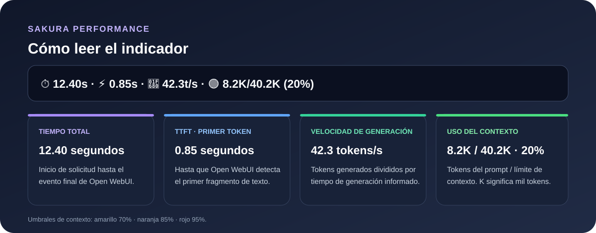

# Sakura Performance

Filtro de Open WebUI y helper local para consultar métricas de generación de un servidor compatible con `llama.cpp`. **Sakura es el nombre de esta configuración; el filtro no está ligado a una IA concreta.**
En cada respuesta, el indicador muestra cuánto tarda Sakura, cuándo empieza a responder, a qué velocidad genera y cuánto contexto ocupa. Así puedes detectar demoras y ver si el contexto se acerca a su límite.

Ejemplo en Open WebUI:

> ⏱️ 6.41s · ⚡ 5.86s · 🚀 49.9t/s · 🟢 2.4K/40.2K (6%)


## Archivos

- `filter.py`: filtro de Open WebUI que muestra tiempo total, tiempo hasta el primer token, velocidad de generación y uso del contexto.
- `metrics.py`: servicio Flask local con los endpoints `/health` y `/snapshot`.
- `requirements.txt`: dependencias del helper.

## Requisitos

- Open WebUI instalado directamente en Windows con Python.
- Un servidor compatible con la API de `llama.cpp` que exponga `/metrics` y `/slots` (el ejemplo usa el puerto `50002`).
- Python disponible desde PowerShell o Símbolo del sistema.

## Configurar el filtro

1. En Open WebUI, abre **Admin Panel → Functions** (en algunas versiones aparece como **Workspace → Functions**).
2. Crea una función/filtro nuevo y pega el contenido de `filter.py`, o importa el archivo si tu versión ofrece esa opción.
3. Guarda y activa el filtro.
4. En los ajustes del filtro, confirma `server_url` como `http://127.0.0.1:50002`. Si el servidor usa otro puerto, cambia este valor.
5. Habilítalo para cualquier modelo que Open WebUI envíe a ese servidor compatible con `llama.cpp`.

El filtro consulta `/metrics` para estimar los tokens generados y `/slots` para calcular el uso del contexto. Si esos endpoints no están disponibles, seguirá mostrando los tiempos de la respuesta y usará los valores de contexto de reserva.

El filtro puede usarse con distintos modelos de IA siempre que se sirvan mediante un backend compatible con `llama.cpp` y ofrezcan estas rutas y métricas. En otros tipos de backend, las rutas y los nombres de las métricas pueden ser diferentes y habría que adaptar el código.

## Configurar el helper de métricas (opcional)

Abre PowerShell en esta carpeta y ejecuta:

```powershell
python -m pip install -r requirements.txt
python metrics.py
```

El helper queda escuchando solo en el equipo local, en `127.0.0.1:5050`. Puedes comprobarlo en el navegador:

- `http://127.0.0.1:5050/health`: estado de conexión y cantidad de métricas.
- `http://127.0.0.1:5050/snapshot`: resumen JSON de tokens, tiempos y velocidad.

El helper lee `http://127.0.0.1:50002/metrics`. Si el servidor usa otro puerto, edita `LLAMA_METRICS` en `metrics.py`.

## Seguridad y repositorio

No incluyas claves API, contraseñas, tokens, archivos de modelos, registros, audio generado ni rutas privadas de la máquina. Estos archivos no contienen credenciales. Mantén cualquier configuración local fuera del repositorio.


## Cómo leer el indicador



Ejemplo:

> ⏱️ 12.40s · ⚡ 0.85s · 🚀 42.3t/s · 🟢 8.2K/40.2K (20%)

- **12.40s — tiempo total:** desde que Open WebUI inicia la solicitud hasta que recibe el evento final. Incluye el procesamiento del prompt, la generación y la comunicación entre componentes.
- **0.85s — TTFT (tiempo hasta el primer token):** hasta que el filtro detecta el primer fragmento de contenido. Es una medida desde Open WebUI y no necesariamente coincide con el tiempo de prefill interno del servidor.
- **42.3t/s — velocidad de generación:** tokens generados divididos entre los segundos de generación informados por llama.cpp. No es el tiempo total dividido entre tokens.
- **8.2K/40.2K (20%) — contexto:** tokens de prompt reportados por el primer slot respecto al límite de contexto; K significa mil tokens. El color cambia a amarillo desde 70%, naranja desde 85% y rojo desde 95%.

**Nota:** las métricas de tokens de llama.cpp son contadores del servidor. Si hay varias solicitudes simultáneas, la velocidad puede incluir actividad concurrente y no corresponder exclusivamente a una conversación. El indicador de contexto depende de que `/slots` exponga el slot activo.
